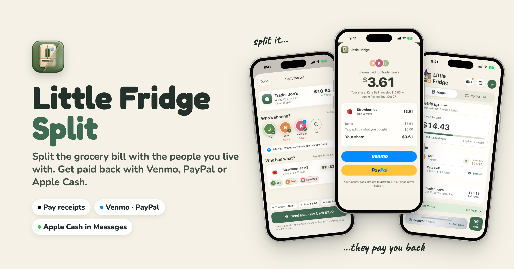
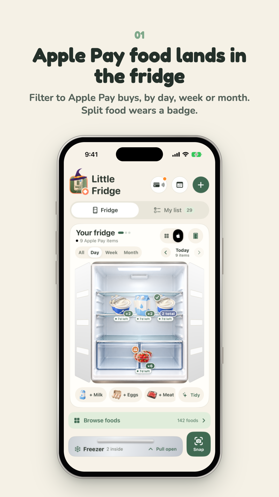
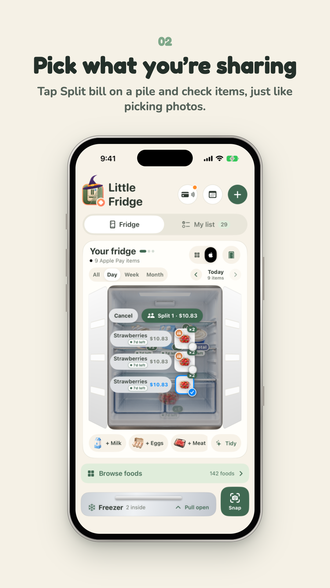
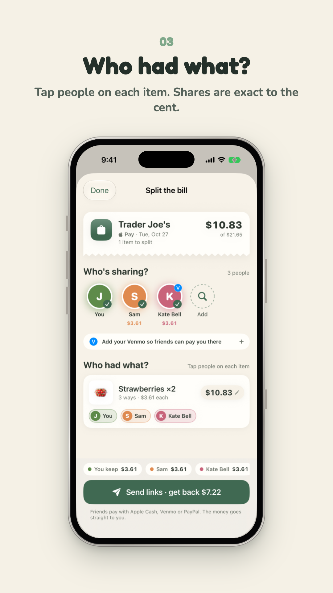
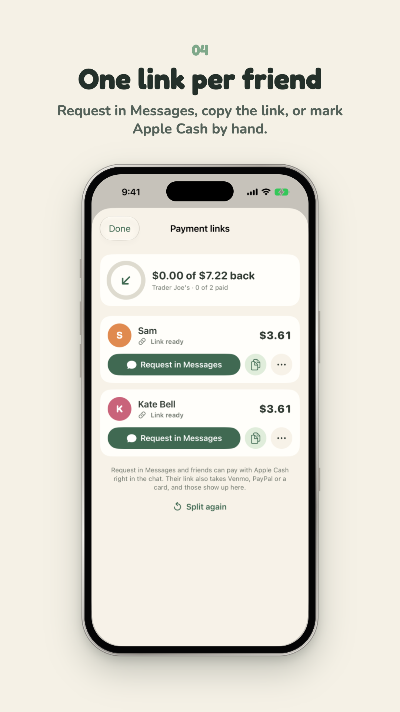
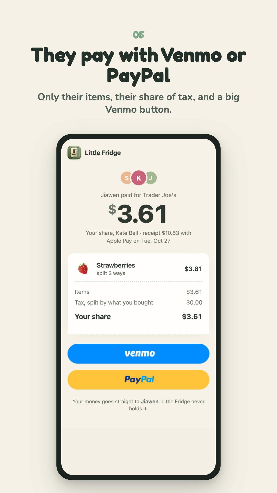
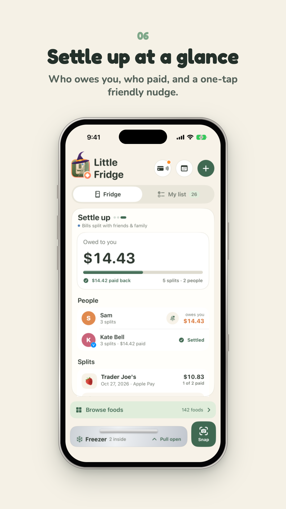
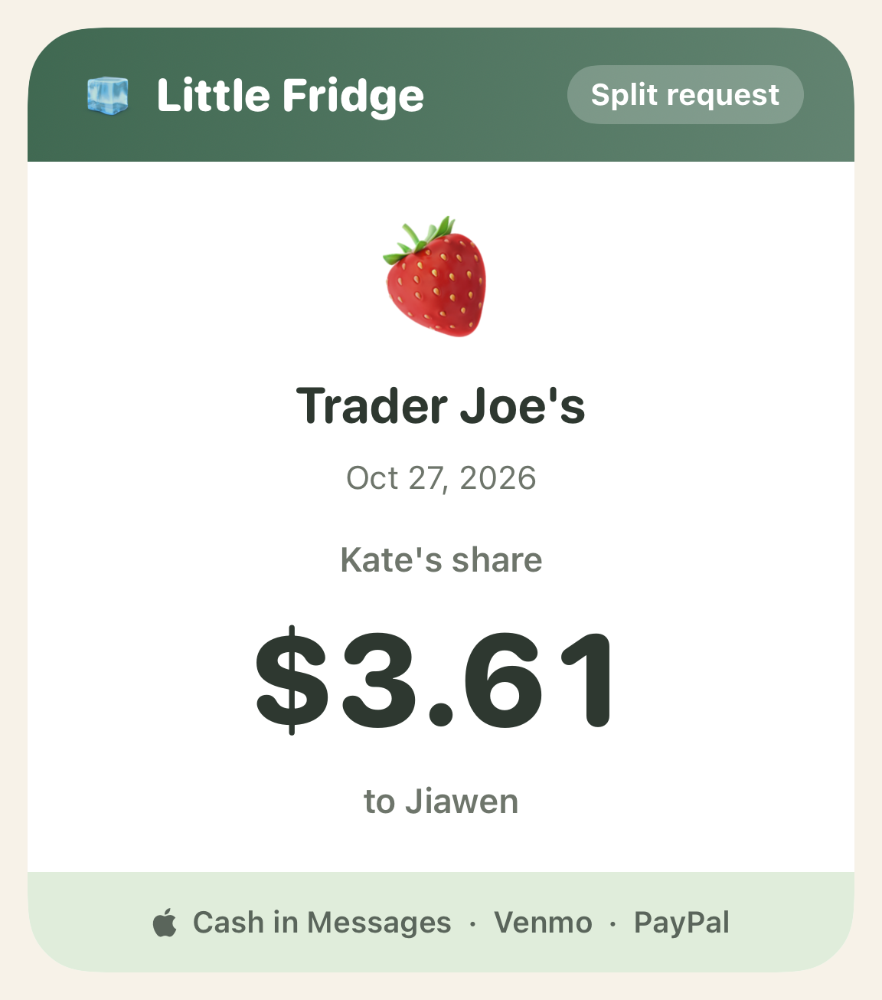
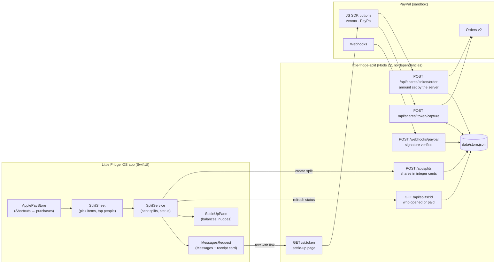

# 🧊 Little Fridge Split 💸

[](https://nodejs.org)
[](https://developer.paypal.com/docs/api/orders/v2/)
[](https://developer.paypal.com/docs/checkout/pay-with-venmo/)
[](https://support.apple.com/apple-cash)
[](#-verification--test-results)
[](https://paypalaihackathon.devpost.com/)
[](LICENSE)

> **Little Fridge Split** turns a grocery receipt into "you owe me" links that actually get paid. You tap Apple Pay at the
> store, and [Little Fridge](https://little-fridge-2026.web.app) already knows what's in the bag. Pick what you're
> sharing, tap who had what, and each friend gets a link with **only their items** and a big **Venmo** button, or a text
> they can pay with **Apple Cash** right in Messages. The money goes straight to you. Little Fridge never holds it.

Built for the [PayPal AI Hackathon](https://paypalaihackathon.devpost.com/). This repo is the payment server and the
friend-facing settle-up page; the iOS screens live in the Little Fridge app.

---

## 📸 Visual Showcase

<div align="center">
  
</div>

<br/>

### 📱 The Whole Flow (iPhone 17 simulator, Oct 27, 2026)

| 1. Bought with Apple Pay | 2. Pick What You Share | 3. Who Had What? |
| :---: | :---: | :---: |
|  |  |  |
| **Apple Pay food, by day, week or month** | **Photos-style picking inside a pile** | **Exact shares, down to the cent** |

| 4. One Link Per Friend | 5. They Pay Back | 6. Settle Up |
| :---: | :---: | :---: |
|  |  |  |
| **Request in Messages, or copy the link** | **Only their items, one big Venmo button** | **Who owes you, who paid, one-tap nudge** |

<sub>Every screen is a real capture of the current build and of this server running locally with PayPal sandbox. The
Apple Pay purchase came from the app's "Simulate Apple Pay Tap" button, and Kate's Apple Cash payment was marked by
hand; no real money moved.</sub>

---

## 🌟 Key Features

### 1. 🛒 From the Receipt, Not From Memory
- **Apple Pay knows the shop**: a Shortcuts automation logs each Apple Pay grocery tap, and the items land in the fridge
  with their store, date and price.
- **Find last Saturday's shop fast**: filter the fridge to Apple Pay food, then by **Day · Week · Month**, stepping back
  with ‹ › or a swipe.
- **Never split twice**: food that's already split wears a small badge, orange while friends owe, a green check once
  everyone has paid.

### 2. ✂️ Split It Like You'd Explain It
- **Pick like Photos**: open a pile, tap *Split bill*, and check the items you're sharing. One item skips the picking.
- **Tap who had what**: everyone sharing an item splits it evenly; "You keep" shows your own share.
- **Fair to the cent**: shares are computed in integer cents with largest-remainder rounding, and tax is spread in
  proportion to what each person bought, so the shares always add up to the receipt.

### 3. 💸 Getting Paid Back
- **Venmo first**: each friend's page has a **Venmo** button and a **PayPal** button from the PayPal JS SDK
  (`enable-funding=venmo`), backed by **PayPal Orders v2**.
- **A free fallback**: when PayPal can't offer Venmo on a phone, the page shows a big *Pay in the Venmo app* button
  (`venmo://paycharge`) addressed to the organizer's Venmo handle, with the amount and note filled in.
- **Apple Cash in Messages**: *Request in Messages* opens a text with the amount, the link, and a receipt card the app
  draws. Apple has no API to prefill an Apple Cash amount, so the text tells your friend to tap + → Apple Cash.

<div align="center">
  
</div>

### 4. 🤝 Settle Up
- **A third face on the fridge card**: Fridge → Spending → **Settle up**, with three animated dots.
- **At a glance**: what you're owed, how much has come back, and each person's balance, biggest first.
- **Status you can trust**: each share moves *Requested → Opened → Paid*, and a PayPal capture or webhook marks it paid.
  Apple Cash and free Venmo payments are marked by hand, and the phone keeps that mark even after the server refreshes.
- **Friendly nudges**: the bell drafts one reminder for everything a friend owes, grouping splits from the same shop and
  day ("Trader Joe's (Oct 27, 3 splits)").

---

## 📐 Technical Architecture



### How the money moves

```
Friend's phone ── /s/<token> settle-up page ── Venmo / PayPal button (PayPal JS SDK, enable-funding=venmo)
                         │
Backend (Node 22) ───────┤ POST /api/shares/:token/order    → PayPal Orders v2, amount set by the server
                         │ POST /api/shares/:token/capture  → capture, check amount + custom_id, mark paid once
                         │ POST /webhooks/paypal            → verify signature, mark paid even if the page was closed
                         ▼
Organizer's PayPal / Venmo balance          (free path: venmo://paycharge, or Apple Cash in Messages, marked by hand)
```

- **The server sets every amount.** The browser only says which share it's paying.
- Each order's `custom_id` is `<split>|<person>`. A capture or webhook marks a share paid only if the amount and
  `custom_id` match, and a replay never pays twice.
- Venmo's own developer API is retired, so Venmo payments go through PayPal Checkout.

### Fair-share math

Each line's price $c$ is split evenly among the $n$ people who had it, and the extras $E$ (tax, tip, fees) are spread in
proportion to each person's item subtotal $s_i$:

$$\text{share}_i = \sum_{\text{lines } \ni i} \frac{c}{n} \; + \; E \cdot \frac{s_i}{\sum_j s_j}$$

Every division uses largest-remainder rounding in whole cents, so $\sum_i \text{share}_i$ always equals the receipt total
exactly ([`server/split.js`](server/split.js)).

---

## 🔌 API

| Method & path | What it does |
| :--- | :--- |
| `GET /api/config` | Public PayPal client ID and environment for the page (also the Render health check). |
| `POST /api/splits` | The iOS app creates a split: people, lines, extras, organizer. Returns one share link per friend. |
| `GET /api/splits/:id` | The app asks who has opened or paid. |
| `GET /api/shares/:token` | A friend's share: their items, tax, total, organizer. Viewing it marks the share *opened*. |
| `POST /api/shares/:token/order` | Creates a PayPal order for that share, with the amount taken from the server. |
| `POST /api/shares/:token/capture` | Captures the approved order and marks the share paid if everything matches. |
| `POST /webhooks/paypal` | Verifies PayPal's signature and marks the share paid on `PAYMENT.CAPTURE.COMPLETED`. |
| `GET /s/:token` | The settle-up page itself (`web/settle.html`). |

Cross-site `POST` requests are refused (the `Origin` must match the host), except PayPal's webhook.

---

## 📁 Project Structure

```
little-fridge-split/
├── README.md                     # This guide
├── LICENSE                       # MIT License
├── SPIKE.md                      # Day-1 findings: what PayPal sandbox allows
├── package.json                  # Node 22, zero runtime dependencies
├── render.yaml                   # One-click Render deploy (secrets set in the dashboard)
├── .env.example                  # Every setting the server reads
│
├── server/
│   ├── index.js                  # HTTP server, routes, webhook, static files
│   ├── paypal.js                 # Orders v2, capture, webhook signature check
│   ├── split.js                  # Integer-cent split math and Venmo links
│   └── store.js                  # JSON-file storage (Firestore later)
│
├── web/
│   ├── index.html                # Landing page
│   ├── settle.html               # The friend's settle-up page
│   ├── settle.js                 # PayPal / Venmo buttons and the Venmo-app fallback
│   ├── style.css                 # Little Fridge look: paper, green, rounded
│   └── img/                      # Food art shown next to each item
│
├── data/
│   └── demo.json                 # Demo receipt behind /s/demo-sam
│
├── spike/                        # One-off sandbox scripts used for SPIKE.md
├── tests/
│   ├── split.test.mjs            # Split math and Venmo links
│   └── server.test.mjs           # Orders, captures and webhooks against a mocked PayPal
│
└── docs/images/                  # README banner and screenshots
```

The iOS side (`SplitSheet.swift`, `SplitService.swift`, `SettleUpPane.swift`, `MessagesRequest.swift`,
`FridgePeriod.swift`) lives in the Little Fridge app.

---

## 🧪 Verification & Test Results

```bash
$ npm test
# tests 5
# pass 5
# fail 0
```

| Test | Where | What it proves |
| :--- | :---: | :--- |
| **spread always adds up to the total** | server | Largest-remainder rounding never loses or invents a cent. |
| **shared items and tax split so shares equal the receipt** | server | Shared lines and proportional tax add up to the receipt. |
| **unassigned items are rejected** | server | Every line needs at least one person. |
| **Venmo link prefills recipient, amount and note** | server | The free `venmo://` and web links are built correctly. |
| **orders pay the organizer, use server amounts, and only matching captures mark a share paid** | server | Amounts come from the server; captures and webhooks with the wrong amount or `custom_id` are ignored. |
| **`SplitTests` + `FridgePeriodTests`** | iOS app | 73 app tests pass, including settle balances, Messages text, grouped nudges, matching prices and keeping hand-marked payments. |

**Live sandbox results** are written up in [SPIKE.md](SPIKE.md): a Venmo payment to the app's own sandbox merchant was
approved and captured end to end. Paying *another* merchant needs PayPal partner onboarding, so for the hackathon the
organizer is the app's own sandbox merchant.

---

## 🚀 Quick Start & Local Setup

### Prerequisites
- **Node.js** 22 or newer (no `npm install` needed: there are no runtime dependencies)
- A **PayPal sandbox** REST app ([developer.paypal.com](https://developer.paypal.com)) and a sandbox personal account to pay with

### 1. Clone and configure
```bash
git clone https://github.com/JiawenZhu/little-fridge-split.git
cd little-fridge-split
cp .env.example .env
```
Fill in `PAYPAL_CLIENT_ID` and `PAYPAL_CLIENT_SECRET` from your sandbox app. Leave `ORGANIZER_MERCHANT_ID` empty to pay
the account that owns the app.

### 2. Run the tests
```bash
npm test
```

### 3. Start the server
```bash
npm run dev
```
Open `http://localhost:8787/s/demo-sam` for Sam's share of the demo receipt. In sandbox, the Venmo button opens PayPal's
"Venmo Sandbox" page; sign in with one of PayPal's documented Venmo sandbox test users, never a real Venmo account.

### 4. Connect the iPhone app
Debug builds of Little Fridge talk to `http://<your-mac>.local:8787` on a device and `localhost:8787` in the simulator.
Release builds use the deployed server.

### 5. Deploy
`render.yaml` deploys the server to [Render](https://render.com). Set `PAYPAL_CLIENT_ID`, `PAYPAL_CLIENT_SECRET`,
`PAYPAL_WEBHOOK_ID` and `ORGANIZER_VENMO` in the Render dashboard, then register a PayPal webhook for
`https://<your-service>.onrender.com/webhooks/paypal`.

---

## 🗺️ Roadmap

- [x] Settle-up page with Venmo and PayPal (Orders v2), server-set amounts, webhook-confirmed payments
- [x] iOS: pick items, tap people, payment links, Messages + Apple Cash, Settle up, nudges
- [ ] Deploy to Render and register the live webhook
- [ ] **AI:** Claude reads the receipt photo and proposes who had what, with a reason for each item
- [ ] **AI:** edit the split by talking ("Maya skips the beer")
- [ ] **Agent:** reminders and formal PayPal invoices with the PayPal Agent Toolkit
- [ ] Firestore instead of the JSON file, and Apple Pay on the settle-up page

---

## 🛡️ Security & Privacy Notice

- **Zero hardcoded secrets**: PayPal credentials live only in the untracked `.env` and in Render's dashboard.
  `.gitignore` excludes `.env` and the live `data/store.json`.
- **Amounts are never trusted from the browser**: the server computes every share and every order amount.
- **Verified payments only**: captures must match the share's amount and `custom_id`; webhooks must pass PayPal's
  signature check.
- **Little Fridge never holds money**: payments go straight from the friend to the organizer's PayPal or Venmo.
- **Share links are random tokens** and show only that friend's items and share, never anyone else's.

---

## 📜 License & Credits

Created with ❤️ by **Jiawen Zhu**.
- Food art comes from the Little Fridge app's original illustrations.
- Payments by [PayPal](https://developer.paypal.com) and [Venmo](https://venmo.com) through PayPal Checkout.
- Distributed under the [MIT License](LICENSE).
